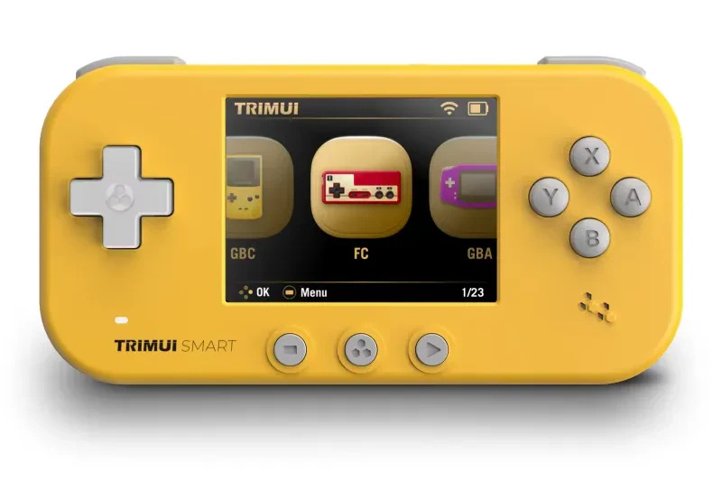
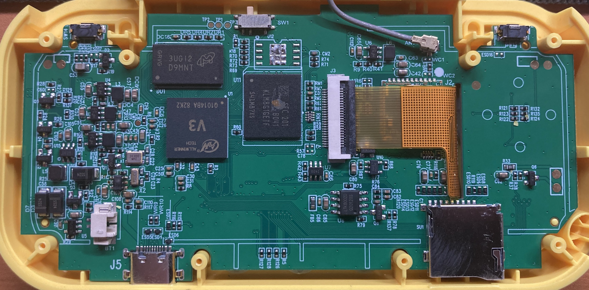

# MinUI — TrimUI Smart

A fork of [MinUI](https://github.com/shauninman/MinUI) focused entirely on the **TrimUI Smart** (`trimuismart`), adding arcade support, WiFi, Bluetooth audio, cheats, and clock sync.

> [!NOTE]
> This fork only targets the original TrimUI Smart (Allwinner S3, 320×240). Other
> devices are inherited from upstream and are untested here. If you have a
> different handheld, use [upstream MinUI](https://github.com/shauninman/MinUI).

<table><tr>
<td valign="middle"></td>
<td valign="middle"></td>
</tr></table>

## What This Fork Adds

| Feature | Summary |
| --- | --- |
| **Arcade** | Neo Geo, CPS-1 and CPS-2 via split FB Alpha cores, with automatic BIOS handling |
| **Arcade Names** | A tool that turns cryptic ROM filenames (`mslug.zip`) into real titles |
| **Battery Graph** | See what the battery actually does over time, with a runtime estimate |
| **Bluetooth** | Scan, pair, connect, and route all audio to a speaker or headphones — including AirPods |
| **Cheats** | RetroArch-format `.cht` files, toggled per code from the in-game menu |
| **Sync Clock** | The Smart has no RTC — set the clock from NTP so it survives a power cycle |
| **WiFi** | Scan, pick a network, type the password on an on-screen keyboard, auto-connect on boot |

Everything else behaves like upstream MinUI: no themes, no boxart, no settings to fiddle with.

## Supported Consoles

- Famicom Disk System
- Game Boy
- Game Boy Advance
- Game Boy Color
- Neo Geo Pocket (and Color)
- Nintendo Entertainment System
- PlayStation
- Pokémon mini
- Sega 32X
- Sega Game Gear
- Sega Genesis
- Sega Master System
- Super Game Boy
- Super Nintendo Entertainment System
- TurboGrafx-16 (and TurboGrafx-CD)
- Virtual Boy

**Arcade** *(added by this fork)*

| System | Folder | Core |
| --- | --- | --- |
| CPS-1 | `Roms/CPS-1 (CPS1)` | `fbalpha2012_cps1` |
| CPS-2 | `Roms/CPS-2 (CPS2)` | `fbalpha2012_cps2` |
| Neo Geo | `Roms/Neo Geo (NEOGEO)` | `fbalpha2012_neogeo` |

> [!IMPORTANT]
> These are the **split** FB Alpha cores (roughly FBA 0.2.97.29). ROMs must match
> that vintage — a modern FBNeo set will not load. A single unified "Arcade"
> folder is **not** supported; put each system's ROMs in its own folder above.

---

## Arcade Setup

### Controls

**CPS-1 / CPS-2** use all six buttons, laid out like an arcade cabinet:

|  | Light | Medium | Heavy |
| --- | --- | --- | --- |
| **Punch** | `Y` | `X` | `L` |
| **Kick** | `B` | `A` | `R` |

**Neo Geo** uses its native four buttons: `A` `B` `X` `Y`.

No configuration needed — these are the cores' defaults.

### Game Names

Arcade ROMs are named things like `mslug.zip` and `ssf2t.zip`. MinUI reads a
`map.txt` in each ROM folder to display real titles instead.

```sh
tools/make-arcade-map.sh "/path/to/Roms/CPS-2 (CPS2)"
```

Run it once per arcade folder. It reads the `.zip` files already there, looks up
their titles in FB Alpha's gamelist (downloaded automatically), and writes
`map.txt`. It **only writes names** — it never moves, renames, or deletes a ROM.

### Neo Geo BIOS

Put `neogeo.zip` in **`Bios/NEOGEO/`** and forget about it.

The core actually wants the BIOS in the ROM folder, not the BIOS folder — so the
Neo Geo pak copies it next to the game at launch and removes it on exit. That
keeps `neogeo` out of your game list, and it never touches a `neogeo.zip` you
placed in the ROM folder yourself.

---

## Cheats

Drop RetroArch-format `.cht` files in `Cheats/<SYSTEM>/`, named to match the ROM:

```
Cheats/GB/Super Example World.cht
```

In-game, open the menu and go to **Options → Cheats**. Each code is listed with
its description and toggles `OFF` / `ON`. Changes apply immediately, and your
choices are remembered per game.

> [!TIP]
> Filenames are matched flexibly — with or without the ROM extension, with or
> without region tags like `(USA)`, and honoring the display names in `map.txt`.
> Most cheat packs work as-is.

---

## Tools

### Battery Graph

**Tools → Battery**

The launcher samples the battery level in the background, and this shows it as a
graph over time — with a time axis and an estimate of how much runtime is left.
Useful for actually knowing what your battery does under load, rather than
guessing from a four-bar icon.

### Bluetooth

**Tools → Bluetooth**

Scan, pair, and connect a Bluetooth speaker or headphones, then flip **Audio to
Bluetooth** to send everything — games, menus, the lot — to it. Turn it off and
audio returns to the built-in speaker. The volume buttons control Bluetooth
playback as well as the built-in speaker.

> [!NOTE]
> **AirPods Pro work**, but need two steps the first time: choose **Connect a
> device** to pair (hold the case button until the light flashes white), then
> choose it again to connect. After that it connects in one step.
>
> This fork ships **BlueZ 5.66** and **bluez-alsa v4**, built from source and
> started at boot from the SD card, because the stock firmware's BlueZ 5.54
> cannot complete A2DP negotiation with AirPods. Nothing in the stock system is
> permanently replaced — **delete `Tools/trimuismart/Bluetooth.pak` to go back
> to the factory Bluetooth driver** (takes effect on the next boot). Turning on **Audio to Bluetooth** also turns WiFi off, because the two
> share one antenna; turning it off again reconnects WiFi.

> [!WARNING]
> **Latency is roughly 200ms.** That's inherent to A2DP plus the receiving
> device's own buffering, not something this fork can fix. Fine for menus, RPGs,
> and slower games; **not recommended for anything twitchy.**

> [!WARNING]
> **Audio may stutter on CPU-heavy systems.** The S3 has a single core doing both
> emulation and SBC encoding. Game Boy and Game Boy Color are clean; NES, SNES,
> PlayStation and arcade can pop or stutter over Bluetooth.

### Sync Clock

**Tools → Sync Clock**

The TrimUI Smart has **no real-time clock** — no battery-backed RTC — so it has
no idea what time it is when you power it on. Out of the box it starts at
1 January 1970 and stays there.

This tool sets the clock from an NTP server over WiFi and saves it, so the
correct time is restored on the next boot. Sync it once and you're set; sync
again whenever it drifts.

> [!NOTE]
> The clock runs in **UTC** — MinUI sets the system clock with `date -u`, so no
> timezone offset is applied.

> [!IMPORTANT]
> Connect to WiFi first (**Tools → Wifi**). This tool doesn't turn the radio on
> for you — if there's no connection it will say so and exit.

### WiFi

**Tools → Wifi**

Scan for networks, pick one, and type the password on an on-screen keyboard.
Credentials are saved, so it reconnects on its own next time. Turn on **Start on
boot** and WiFi comes up automatically at every boot.

---

## Other Improvements

- **Bluetooth volume** — the volume buttons control Bluetooth playback, not just
  the built-in speaker.
- **Japanese / CJK game names** — the UI font renders Chinese, Japanese, and
  Korean characters, so import ROMs with native-script filenames display properly
  instead of as empty boxes. A second font is bundled and can be selected in the
  config.
- **Scrolling titles** — long game names scroll (marquee-style) when highlighted,
  instead of being cut off mid-word.

---

## Installing

Each release is a single zip, `MinUI-trimuismart-<date>-<n>.zip`, laid out
exactly as it goes on the card:

1. Format the SD card as FAT32 (MBR).
2. Unzip the release and copy everything in it to the root of the card: the
   `trimui` folder, `MinUI.zip` (**don't** unzip it), and the `Bios`, `Roms`,
   `Saves`, `Emus` and `Tools` folders.
3. Boot the TrimUI Smart. The stock firmware runs `trimui/` once to install
   MinUI, which then unpacks `MinUI.zip` and starts.

**Updating:** copy the new zip's contents over the card. Games, saves and
settings are kept; the new `MinUI.zip` installs on the next boot.

The zip's `README.txt` covers bios file names, disc games, collections and the
button shortcuts.

---

## Credits

Built on [**MinUI**](https://github.com/shauninman/MinUI) by Shaun Inman (GPL-3.0).

- Arcade emulation via the [**FB Alpha**](https://github.com/libretro/fbalpha) split cores.
- [**BlueZ**](http://www.bluez.org/) (GPL-2.0) and [**bluez-alsa**](https://github.com/arkq/bluez-alsa) by arkq (MIT), cross-compiled for this platform.
- The CJK font and the WiFi engine (`generic_wifi.c`) are adapted from [**NextUI**](https://github.com/LoveRetro/NextUI) (GPL-3.0).
- The UI binaries (`minui-keyboard`, `minui-list`, `minui-presenter`) are josegonzalez's, cross-compiled for this platform (MIT).
- `Wifi.pak` is adapted from [**minui-wifi-pak**](https://github.com/josegonzalez/minui-wifi-pak) by josegonzalez (MIT).
